<div align="center">


[](https://git.io/typing-svg)

<br />

[](https://www.linkedin.com/in/keerthivasan1845/)
[](https://instagram.com/keerthi__krrish)
[](mailto:keerthivasan1845@gmail.com)


</div>

<div align="center">

`AI / ML ENGINEER` &nbsp;•&nbsp; `GEN AI BUILDER` &nbsp;•&nbsp; `AGENTIC WORKFLOWS` &nbsp;•&nbsp; `MLOPS`

</div>

---

## 🧠 System Profile

> I build practical AI systems that turn complex ideas into dependable products—designed from the first architecture sketch through deployment and iteration.

```text
FOCUS       Generative AI · Agentic AI · Retrieval-Augmented Generation
MISSION     Build AI that is useful, observable, scalable, and ready for real-world use
WORKFLOW    Problem framing → AI architecture → development → deployment
EXPLORING   Multimodal intelligence · fine-tuning · industrial AI automation
```

<table>
  <tr>
    <td width="33%" align="center"><b>🔎 RAG Systems</b><br/><sub>Grounded answers, retrieval pipelines, semantic search, knowledge assistants</sub></td>
    <td width="33%" align="center"><b>🕸️ Agentic Workflows</b><br/><sub>Tool-using agents, orchestration, multi-step reasoning, human review</sub></td>
    <td width="33%" align="center"><b>⚙️ AI Automation</b><br/><sub>Reliable workflows that reduce repetitive work and create business value</sub></td>
  </tr>
</table>

## ✦ AI Stack & Frameworks

<div align="center">

### LLM Engineering & Agentic AI


### ML, Data & Visual Intelligence


### APIs, Data Stores & Platform Engineering


</div>

## 🧩 Engineering Blueprint

```mermaid
flowchart LR
    A[Problem & Data] --> B[AI Architecture]
    B --> C[RAG / Agents / ML]
    C --> D[API & Evaluation]
    D --> E[Cloud Deployment]
    E --> F[Monitoring & Iteration]
    style A fill:#0f172a,stroke:#22d3ee,color:#e2e8f0
    style B fill:#172554,stroke:#60a5fa,color:#e2e8f0
    style C fill:#312e81,stroke:#a78bfa,color:#e2e8f0
    style D fill:#3f1d5b,stroke:#c084fc,color:#e2e8f0
    style E fill:#164e63,stroke:#22d3ee,color:#e2e8f0
    style F fill:#14532d,stroke:#4ade80,color:#e2e8f0
```



## 🔬 Current Build Modes

| `01` | `02` | `03` |
| --- | --- | --- |
| **Knowledge Intelligence**<br/>Making organizational knowledge searchable, traceable, and useful with RAG. | **Autonomous Workflows**<br/>Designing agent systems that can plan, use tools, and escalate when needed. | **Production AI**<br/>Moving models from notebooks to observable APIs, containers, and cloud environments. |

## 📊 GitHub Telemetry

<div align="center">


<br />


</div>


## 📡 Open Channel

I’m always interested in conversations around useful AI, agentic systems, and thoughtful engineering.

<div align="center">

[](https://www.linkedin.com/in/keerthivasan1845/)
[](mailto:keerthivasan1845@gmail.com)

<sub>Designed with curiosity, engineered for impact.</sub>

</div>
